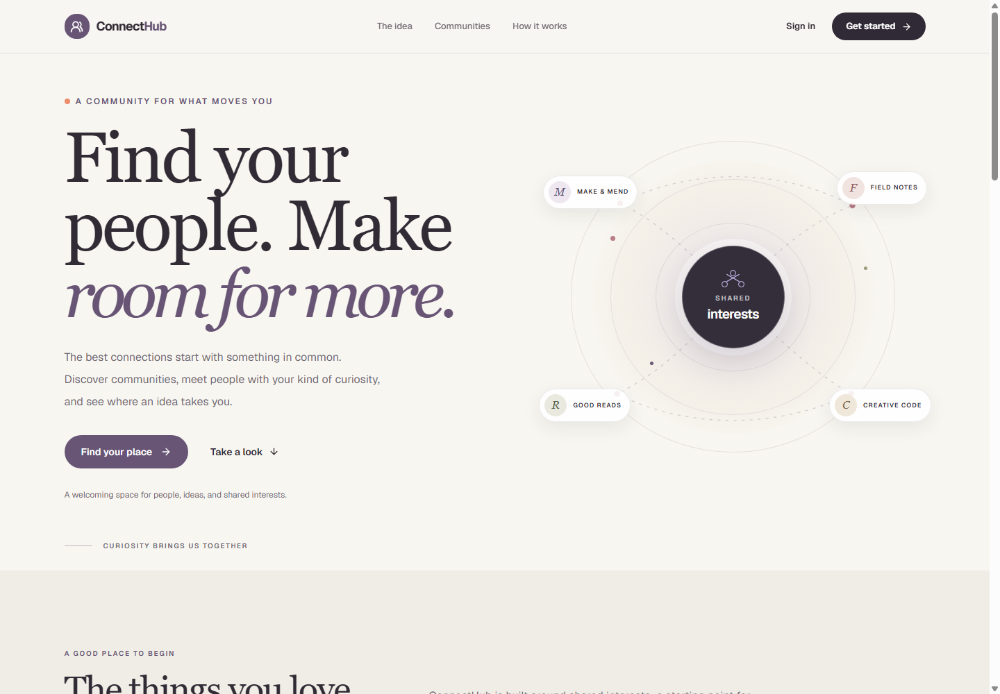

# ConnectHub

A responsive frontend prototype for a social networking and interest-discovery platform. ConnectHub helps people find shared interests, explore communities, and build meaningful connections.

The current app includes local, in-memory demonstrations of discovery, community membership, connection requests, posts, messages, notifications, profile editing, and preferences. These interactions are not backed by a server and reset when the page is refreshed.

## Project Overview

This project is being developed as part of a frontend engineering assignment.

The frontend includes:

- A public landing page and demo sign-in/sign-up flow
- Responsive application navigation and route coverage
- Interactive in-memory previews of ConnectHub features
- Reusable UI, layout, and feature components
- Documented design tokens and wireframes
- Accessibility and frontend quality checks

## Technology Stack

| Technology     | Purpose                         |
| -------------- | ------------------------------- |
| Next.js        | React framework and routing     |
| TypeScript     | Type-safe development           |
| Tailwind CSS   | Styling and responsive design   |
| shadcn/ui      | Reusable UI components          |
| Base UI        | Accessible component primitives |
| Lucide React   | Icons                           |
| ESLint         | Code quality and linting        |
| Git and GitHub | Version control                 |

## Getting Started

### Prerequisites

- Node.js
- npm
- Git

### Installation

Clone the repository:

```bash
git clone https://github.com/Ranjita431/ConnectHub.git
```

Navigate into the project:

```bash
cd ConnectHub
```

Install dependencies:

```bash
npm install
```

Start the development server:

```bash
npm run dev
```

Open http://localhost:3000 in your browser.

## Project Structure

```text
connecthub-frontend/
├── docs/
│   ├── submission-assets/
│   │   ├── screenshots/
│   │   │   ├── landing-page-desktop.png
│   │   │   ├── landing-page-mobile.png
│   │   │   ├── app-shell-desktop.png
│   │   │   └── app-shell-mobile.png
│   │   └── wireframes/
│   │       └── connecthub-wireframes.svg
│   ├── design-system.md
│   ├── product-foundation.md
│   ├── wireframes.md
│   └── submission-checklist.md
├── public/
├── src/
│   ├── app/
│   │   ├── (app)/
│   │   ├── (auth)/
│   │   ├── globals.css
│   │   ├── layout.tsx
│   │   └── page.tsx
│   ├── components/
│   │   ├── dashboard/
│   │   ├── features/
│   │   ├── feedback/
│   │   ├── landing/
│   │   ├── layout/
│   │   └── ui/
│   ├── lib/
├── README.md
└── package.json
```

## Application Routes

| Route                        | Description                                   |
| ---------------------------- | --------------------------------------------- |
| `/`                          | Public landing page                           |
| `/sign-in`                   | Sign-in interface                             |
| `/sign-up`                   | Sign-up interface                             |
| `/home`                      | Home dashboard                                |
| `/explore`                   | Discover people and communities               |
| `/connections`               | Connections interface                         |
| `/communities`               | Communities interface                         |
| `/communities/[communityId]` | Community detail and local discussion preview |
| `/moments`                   | Photo-led moments and story previews          |
| `/messages`                  | Messages interface                            |
| `/notifications`             | Notifications interface                       |
| `/profile/[userId]`          | User profile                                  |
| `/settings`                  | Settings interface                            |

## Screenshots

### Landing Page

**Desktop**



**Mobile**


### Logged-in Home

**Desktop**


**Mobile**


## Wireframes

The wireframe deliverable includes desktop and mobile layouts for the landing page, home, explore, and profile experiences. The editable SVG is provided as the wireframe source; no native Figma `.fig` file is included.

[View the complete ConnectHub wireframes](docs/submission-assets/wireframes/connecthub-wireframes.svg).

## Documentation

Project planning and design documents are available in the `docs/` directory:

- `product-foundation.md` — product overview, goals, routes, and user journeys.
- `design-system.md` — design tokens, typography, spacing, and accessibility rules.
- `wireframes.md` — desktop and mobile layout plans.
- `submission-checklist.md` — Week 1 submission deliverables and quality checks.

## Quality Checks

Run these commands before submitting changes:

```bash
npm run lint
npx tsc --noEmit
npm run build
```

## Current Scope and Limitations

This is a frontend-only prototype.

The prototype does not include:

- Backend or database integration
- Real authentication or password storage
- OAuth integration
- Persistent user data or server-backed feed CRUD
- Real-time or externally delivered messages
- Email delivery or production notifications
- Production authorization or notifications

All people, posts, communities, and activity are fictional sample data. Demo interactions exist only in the current browser session and are not shared with other users.

## Development

The submission branch is `week1-final-submission`, targeting `week1-foundation`. [Pull request #1](https://github.com/Ranjita431/ConnectHub/pull/1) was merged into `week1-foundation` on November 28, 2026.

## License

This project is currently an academic development prototype.
