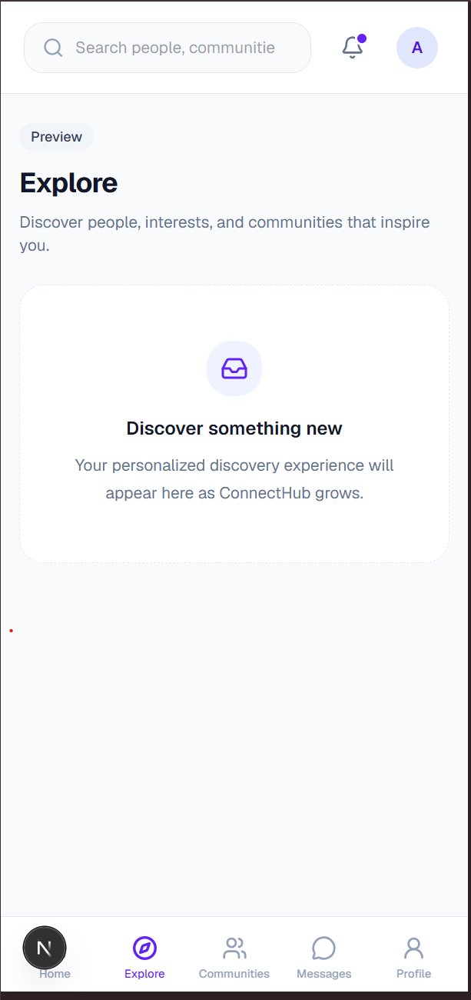
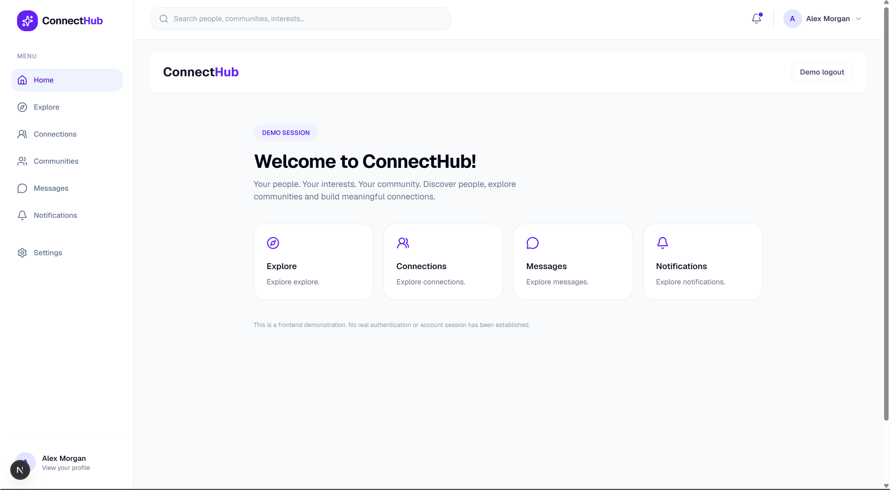
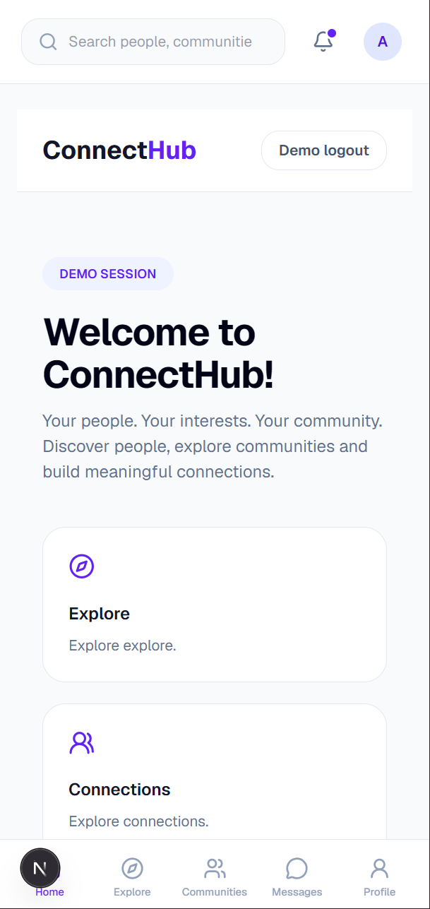

# ConnectHub

A responsive frontend prototype for a social networking and interest-discovery platform.

ConnectHub is designed to help people discover others with shared interests, explore communities, and build meaningful connections.

## Project Overview

This project is being developed as part of a frontend engineering assignment.

The current development phase focuses on:

- Product foundation and user journeys
- Responsive UI design and design tokens
- Reusable frontend components
- Application routing and navigation
- Maintainable project architecture
- Accessibility and frontend quality checks

## Technology Stack

| Technology     | Purpose                         |
| -------------- | ------------------------------- |
| Next.js        | React framework and routing     |
| TypeScript     | Type-safe development           |
| Tailwind CSS   | Styling and responsive design   |
| shadcn/ui      | Reusable UI components          |
| Base UI        | Accessible component primitives |
| Lucide React   | Icons                           |
| ESLint         | Code quality and linting        |
| Git and GitHub | Version control                 |

## Getting Started

### Prerequisites

- Node.js
- npm
- Git

### Installation

Clone the repository:

```bash
git clone https://github.com/Ranjita431/ConnectHub.git
```

Navigate into the project:

```bash
cd ConnectHub
```

Install dependencies:

```bash
npm install
```

Start the development server:

```bash
npm run dev
```

Open http://localhost:3000 in your browser.

## Project Structure

```text
connecthub-frontend/
├── docs/
│   ├── submission-assets/
│   │   ├── screenshots/
│   │   │   ├── landing-page-desktop.png
│   │   │   ├── landing-page-mobile.png
│   │   │   ├── app-shell-desktop.png
│   │   │   └── app-shell-mobile.png
│   │   └── wireframes/
│   │       └── connecthub-wireframes.svg
│   ├── design-system.md
│   ├── product-foundation.md
│   ├── wireframes.md
│   └── submission-checklist.md
├── public/
├── src/
│   ├── app/
│   ├── components/
│   │   ├── ui/
│   │   ├── layout/
│   │   └── feedback/
│   ├── features/
│   ├── constants/
│   ├── hooks/
│   ├── lib/
│   ├── types/
│   └── utils/
├── README.md
└── package.json
```

## Application Routes

| Route               | Description                     |
| ------------------- | ------------------------------- |
| `/`                 | Public landing page             |
| `/sign-in`          | Sign-in interface               |
| `/sign-up`          | Sign-up interface               |
| `/home`             | Home dashboard                  |
| `/explore`          | Discover people and communities |
| `/connections`      | Connections interface           |
| `/communities`      | Communities interface           |
| `/messages`         | Messages interface              |
| `/notifications`    | Notifications interface         |
| `/profile/[userId]` | User profile                    |
| `/settings`         | Settings interface              |

## Screenshots

### Landing Page

**Desktop**


**Mobile**



### Application Shell

**Desktop**



**Mobile**



## Wireframes

The Week 1 wireframe deliverable includes desktop and mobile layouts for the landing page, home, explore, and profile experiences.

[View the complete ConnectHub wireframes](docs/submission-assets/wireframes/connecthub-wireframes.svg).

## Documentation

Project planning and design documents are available in the `docs/` directory:

- `product-foundation.md` — product overview, goals, routes, and user journeys.
- `design-system.md` — design tokens, typography, spacing, and accessibility rules.
- `wireframes.md` — desktop and mobile layout plans.
- `submission-checklist.md` — Week 1 submission deliverables and quality checks.

## Quality Checks

Run these commands before submitting changes:

```bash
npm run lint
npx tsc --noEmit
npm run build
```

## Current Scope and Limitations

This is a frontend-only prototype.

The current phase does not include:

- Backend or database integration
- Real authentication or password storage
- OAuth integration
- Real-time messaging
- Persistent user data
- Production authorization or notifications

Any sample users or content used during development are fictional.

## Development

The Week 1 foundation is developed on the `week1-foundation` branch. Submission documentation and evidence are maintained through the `week1-final-submission` branch and its pull request.

## License

This project is currently an academic development prototype.
